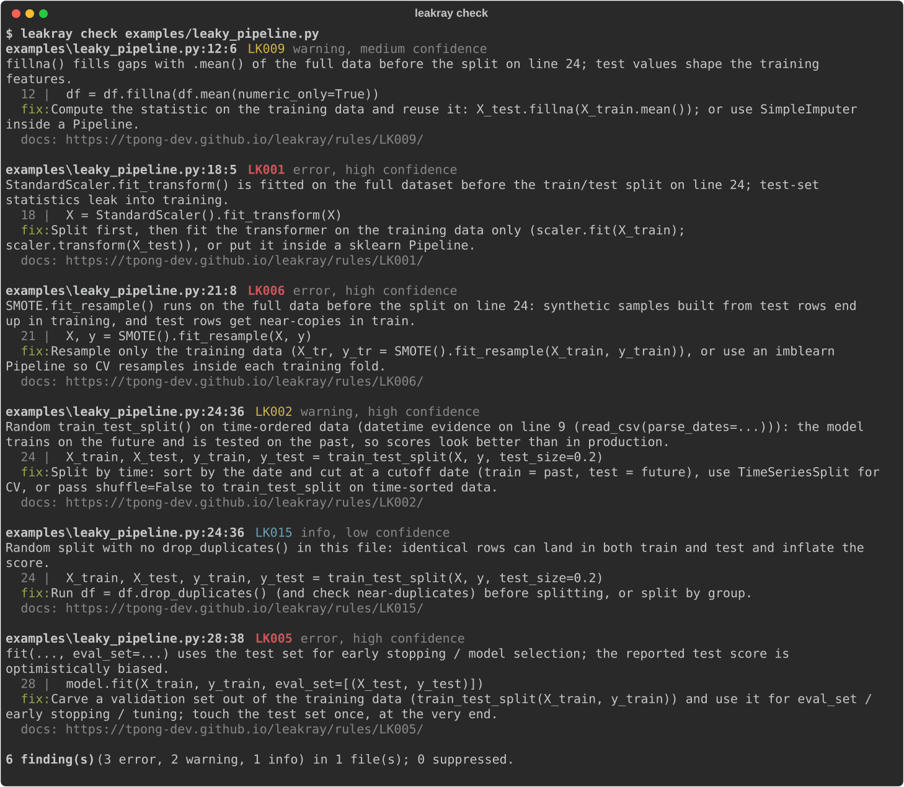

# leakray

[](https://github.com/tpong-dev/leakray/actions/workflows/ci.yml) [](https://tpong-dev.github.io/leakray/) [](pyproject.toml) [](LICENSE)

**Find data leakage in ML code before it inflates your results.** leakray is a fast, zero-config static analyser for Python scripts and Jupyter notebooks. It flags the mistakes that make a model look better in the notebook than it will ever be in production: preprocessing fitted before the split, random splits on time data, the target hiding in the features, tuning on the test set, and 12 more.

```bash
pip install git+https://github.com/tpong-dev/leakray
leakray check .
```

## 30-second demo

`examples/leaky_pipeline.py` is a typical tutorial-style pipeline. leakray reads it without running it:



As plain text:

```text
$ leakray check examples/
examples\leaky_pipeline.py:18:5 LK001 error, high confidence
  StandardScaler.fit_transform() is fitted on the full dataset before the train/test split on line 24; test-set statistics leak into training.
    18 | X = StandardScaler().fit_transform(X)
  fix: Split first, then fit the transformer on the training data only (scaler.fit(X_train); scaler.transform(X_test)), or put it inside a sklearn Pipeline.
  docs: https://tpong-dev.github.io/leakray/rules/LK001/

examples\leaky_pipeline.py:21:8 LK006 error, high confidence
  SMOTE.fit_resample() runs on the full data before the split on line 24: synthetic samples built from test rows end up in training, and test rows get near-copies in train.
    21 | X, y = SMOTE().fit_resample(X, y)
  fix: Resample only the training data (X_tr, y_tr = SMOTE().fit_resample(X_train, y_train)), or use an imblearn Pipeline so CV resamples inside each training fold.

examples\leaky_pipeline.py:24:36 LK002 warning, high confidence
  Random train_test_split() on time-ordered data (datetime evidence on line 9 (read_csv(parse_dates=...))): the model trains on the future and is tested on the past, so scores look better than in production.

examples\leaky_pipeline.py:28:38 LK005 error, high confidence
  fit(..., eval_set=...) uses the test set for early stopping / model selection; the reported test score is optimistically biased.
...
6 finding(s) (3 error, 2 warning, 1 info) in 2 file(s); 0 suppressed.
```

The fixed version, `examples/clean_pipeline.py`, produces no findings.

## Why

Leakage is one of the most common ways ML results go wrong without anyone noticing: the code runs, the score is great, and it does not hold up on new data. Kapoor & Narayanan (2023) surveyed earlier reviews and found leakage affecting at least 294 published papers across 17 fields. Style linters such as ruff and pylint are not built to catch it. leakray does, and it fits into the tools you already use: the CLI, pre-commit, and GitHub code scanning via SARIF.

## Install

```bash
pip install git+https://github.com/tpong-dev/leakray     # until it is on PyPI
```

Python 3.10–3.13, any OS. Its only dependencies are `nbformat` and `rich`. It never imports or runs your code.

## Usage

```bash
leakray check path/ [more paths]          # .py and .ipynb, recursively
leakray check nb.ipynb --format json      # or --format sarif --output leakray.sarif
leakray check . --select LK001,LK004      # only these rules (prefixes work: LK00)
leakray check . --ignore LK015
leakray check . --min-confidence medium   # low | medium | high | 0.0-1.0
leakray check . --fail-on error           # exit 1 only for errors (default: warning)
leakray rules                             # list rules
leakray explain LK003                     # why it leaks + how to fix
```

Exit codes: `0` nothing at or above `--fail-on`, `1` findings, `2` usage or config error. `--exit-zero` always exits 0.

**Notebooks:** code cells are joined in order (like "Run all"), IPython magics are ignored, and findings point to the cell: `nb.ipynb cell 4, line 2`.

**Config** in `pyproject.toml`:

```toml
[tool.leakray]
ignore = ["LK015"]
min-confidence = "medium"
fail-on = "warning"
exclude = ["scratch/*"]
per-file-ignores = { "notebooks/eda_*.ipynb" = ["LK014"] }
```

**Suppress** one line with `# leakray: ignore[LK001]` (or `# leakray: ignore` for all rules), or a whole file with `# leakray: ignore-file[LK002]`.

**pre-commit:**

```yaml
repos:
  - repo: https://github.com/tpong-dev/leakray
    rev: v0.1.0
    hooks:
      - id: leakray            # or leakray-errors-only
```

**GitHub Action** (findings appear as code-scanning alerts on PRs, free for public repos):

```yaml
permissions: { contents: read, security-events: write }
steps:
  - uses: actions/checkout@v4
  - uses: tpong-dev/leakray@v0.1.0
    with: { path: ".", fail-on: "error" }
```

## Rules

| Code | Name | Severity | Catches |
|---|---|---|---|
| [LK001](docs/rules/LK001.md) | preprocessing-fit-before-split | error | scaler / imputer / encoder / PCA fitted on all rows before the split |
| [LK002](docs/rules/LK002.md) | random-split-on-time-series | warning | random `train_test_split` / shuffled K-fold on dated data |
| [LK003](docs/rules/LK003.md) | target-in-features | error | the target column is still in `X` |
| [LK004](docs/rules/LK004.md) | fit-on-test-data | error | `.fit` / `.fit_transform` on the test set |
| [LK005](docs/rules/LK005.md) | tuning-on-test-set | error | `eval_set` / `validation_data` / GridSearchCV / Optuna objective on the test set |
| [LK006](docs/rules/LK006.md) | oversampling-before-split | error | SMOTE / over- or under-sampling before the split or CV |
| [LK007](docs/rules/LK007.md) | feature-selection-before-split | error | SelectKBest / RFE / mutual information / corr-with-target on all rows |
| [LK008](docs/rules/LK008.md) | target-encoding-on-full-data | error | `groupby(cat)[target].mean()` or TargetEncoder on all rows |
| [LK009](docs/rules/LK009.md) | global-fillna-before-split | warning | `fillna(df.mean())` before the split |
| [LK010](docs/rules/LK010.md) | unshifted-target-lag-feature | error | `df[target].rolling(7).mean()` without `.shift()` |
| [LK011](docs/rules/LK011.md) | preprocessing-outside-cv-pipeline | error | preprocessing fitted on all rows, then `cross_val_score` / GridSearchCV |
| [LK012](docs/rules/LK012.md) | kfold-ignores-groups | warning | random K-fold when a `patient_id` / `user_id` column calls for GroupKFold |
| [LK013](docs/rules/LK013.md) | repeated-test-evaluation | warning | scoring the test set in a loop and keeping the best |
| [LK014](docs/rules/LK014.md) | groupby-transform-before-split | warning | group aggregates / frequency encoding over all rows |
| [LK015](docs/rules/LK015.md) | no-dedup-before-random-split | info | random split with no `drop_duplicates()` |
| [LK016](docs/rules/LK016.md) | concat-train-test-before-fit | error | `pd.concat([train, test])` then fitting preprocessing |

Each finding has a rule code, a severity, a confidence (high / medium / low), a location, a message and a fix hint.

## Benchmark

There are 126 labelled snippets (71 leaky, 55 clean), with tricky clean look-alikes such as `transform` on test, Pipelines, `shift().rolling`, TimeSeriesSplit, GroupKFold and `eval_set` on a validation split. They were written **from the rule definitions, independently of the rule code**, and the rules were not tuned on them afterwards, so these are first-contact numbers. Reproduce with `python benchmark/run.py`. The per-case error analysis is in [benchmark/RESULTS.md](benchmark/RESULTS.md).

| Rule | Precision | Recall | | Rule | Precision | Recall |
|---|---:|---:|---|---|---:|---:|
| LK001 | 1.00 | 0.83 | | LK009 | 1.00 | 1.00 |
| LK002 | 0.33 | 0.50 | | LK010 | 0.80 | 1.00 |
| LK003 | 1.00 | 0.50 | | LK011 | 1.00 | 0.75 |
| LK004 | 0.71 | 0.83 | | LK012 | 1.00 | 0.50 |
| LK005 | 1.00 | 0.83 | | LK013 | 1.00 | 0.75 |
| LK006 | 1.00 | 0.60 | | LK014 | 1.00 | 0.50 |
| LK007 | 1.00 | 0.80 | | LK015 | 1.00 | 1.00 |
| LK008 | 0.60 | 0.75 | | LK016 | 1.00 | 1.00 |
| **All (micro)** | **0.86** | **0.76** | | **File level** | **0.90** | **0.80** |

The weak spots are LK002 (it fires on files that only mention a date column) and the recall of LK003, LK012 and LK014 (patterns the simple dataflow does not follow). These are the next things to improve. Per-rule counts are small (4–6 leaky cases each), so treat single-rule numbers as rough.

On real code: run read-only on three of my own ML projects, leakray found 4 issues. 3 were false positives, now fixed and added as regression tests. The 4th is a plausible issue worth reviewing. Details: [docs/dogfood.md](docs/dogfood.md).

## How it works

leakray parses each file with Python's `ast` (notebooks: code cells joined in order) and does one pass of lightweight dataflow. Every variable gets a **role**: `full` (loaded data or derived from it), `train`, `valid`, `test` (from a split: `train_test_split` outputs, CV fold indices, date or positional slices, or names like `X_test`), or `unknown`. It also records which estimator class each `.fit` call belongs to and which data it saw. Rules ask questions of these facts, for example "was a `StandardScaler` fitted on `full` data with a split later in the file?". See [docs/ARCHITECTURE.md](docs/ARCHITECTURE.md).

## Limitations

Static analysis cannot see everything:

- It reads one file at a time. A split done in another module, or data that was already split on disk, is only recognised through names like `train_df` / `test_df`.
- Roles are tracked per variable name and are not followed through lists, dicts or function returns.
- It does not run code, so it cannot see data values: duplicates, actual timestamps, near-duplicate images, or a feature that is a proxy of the target.
- Some rules use name hints (`*_id`, `date`, `target`). These carry low or medium confidence, so use `--min-confidence` to tune the noise.

False positives are bugs. Please [report them](https://github.com/tpong-dev/leakray/issues/new?template=false_positive.yml).

## Prior work

Yang et al., ["Data Leakage in Notebooks: Static Detection and Better Processes"](https://doi.org/10.1145/3551349.3556918) (ASE '22), presented a static analysis for three leak types in notebooks: overlap, multi-test and preprocessing leakage. It is built on Datalog plus pyright type inference, and found leakage in about 30% of over 100,000 public notebooks. NBLyzer (Subotić et al., ICSE-SEIP '22) also analysed notebooks for leakage statically. leakray borrows Yang et al.'s categories. It trades some analysis depth for a pip-installable, zero-config tool that runs on scripts and notebooks in CI (pre-commit, GitHub Action, SARIF), adds leak types beyond those three (time-series splits, group-aware CV, target encoding, unshifted lag features, target in features, deduplication) and gives a fix hint per rule. Other pip-installable static linters exist, for example [mlguard-lint](https://pypi.org/project/mlguard-lint/). Full review: [docs/prior_work.md](docs/prior_work.md).

## Development

```bash
py -3.12 -m venv .venv && .venv\Scripts\activate
pip install -e ".[dev]"
pytest && ruff check . && mypy
```

To add a rule, see [CONTRIBUTING.md](CONTRIBUTING.md). Each rule is one file in `src/leakray/rules/` plus bad and good fixtures in `tests/fixtures/LKxxx/`.

Docs: <https://tpong-dev.github.io/leakray/> · Learning notes: [LEARN.md](LEARN.md) · Releasing: [docs/RELEASING.md](docs/RELEASING.md)

Built with AI assistance (Claude Code). MIT licence.
